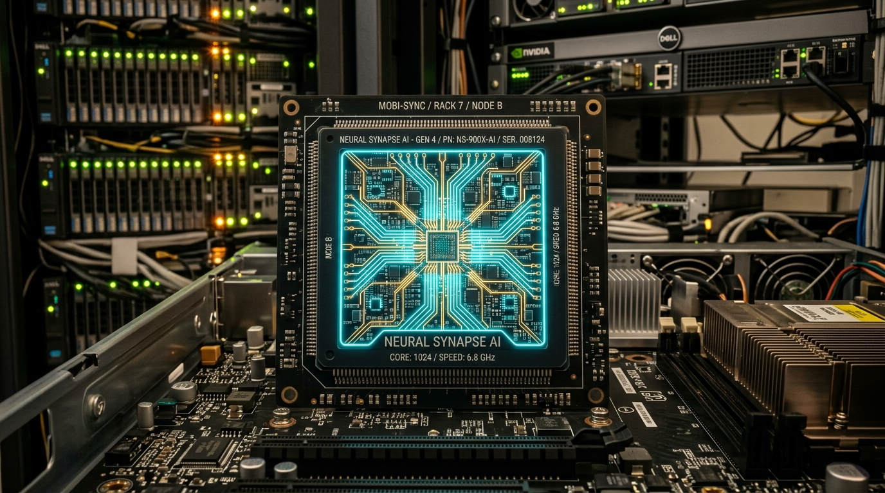

# 📡 AIT NEWS STUDIO (24/7 AI & Tech Broadcast Automation)

An automated, television-grade news broadcast generation and 24/7 YouTube live streaming studio designed to run on local machines or free cloud instances (e.g., Oracle Cloud Free Tier).



---

## ⚡ Key Capabilities

- **📰 Automated Tech & AI RSS Scraper:** Continuously aggregates breaking stories from TechCrunch AI, The Verge, Ars Technica, and Hacker News.
- **🎙️ Neural News Anchor Voice Engine:** Uses Edge-TTS (100% free, zero-cost broadcast neural voices such as `en-US-ChristopherNeural` and `en-US-JennyNeural`).
- **⏱️ Voice-Synchronized Text & Point Animations:** Automatically extracts millisecond sentence boundaries to dynamically highlight bullet points and update lower-third banners in lockstep with the anchor's speech.
- **🎥 Multi-Image Camera Cutting with Ken Burns Motion:** Switches between multiple high-resolution article photos and category-tailored B-roll footage (Cyber Defense Center, AI Synapse Core, High-Density Server Racks) using smooth documentary-style zoom and pan motions.
- **📊 Real-Time Audio Spectrum Waveform:** Animated cyan audio waveform reacting to the news anchor's voice.
- **🎞️ Bloomberg/BBC Style Graphics:** 1080p 30fps layout featuring a live UTC/IST clock, pulsing red LIVE badge, category pill, and continuous scrolling marquee headline ticker.
- **🚀 YouTube Automation & 24/7 RTMP Streaming:**
  - Auto-generated 1280x720 high-CTR YouTube thumbnails.
  - Auto-generated SEO titles, descriptions with chapter timestamps, and tags.
  - 1-click 24/7 YouTube Live RTMP streaming powered by FFmpeg.

---

## 🛠️ Architecture

```
ait_news_studio/
├── app.py                 # FastAPI web control dashboard server
├── config.py              # Feeds, voices, branding, video & RTMP configuration
├── fetcher.py             # RSS scraper, article image extractor & script formatter
├── voice_engine.py        # Neural TTS engine with sentence boundary timing extraction
├── renderer.py            # FFmpeg & PIL broadcast renderer (multi-image, Ken Burns, waveform)
├── studio_manager.py      # High-level coordinator for single clips, bulletins & metadata
├── streamer.py            # Continuous 24/7 YouTube Live RTMP streaming controller
├── assets_builder.py      # Ambient broadcast background bed & asset generator
├── templates/
│   └── index.html         # Modern BBC/Cyberpunk dashboard UI
├── assets/
│   ├── broll/             # High-res B-roll footage (AI chip, cyber defense, datacenter)
│   ├── images/            # Cached article images
│   └── news_ambient_bed.wav
└── output/                # Rendered broadcast MP4s, thumbnails, and metadata
```

---

## 🚀 Quick Start (Local Setup)

### 1. Clone the repository
```bash
git clone https://github.com/Aravindsamy2002/ait-news-studio.git
cd ait-news-studio
```

### 2. Install dependencies
```bash
pip install -r requirements.txt
```

### 3. Launch the Studio Dashboard
```bash
python app.py
```
Open your browser at **`http://127.0.0.1:8765`**.

---

## ☁️ Deploying on Oracle Cloud Free Tier (24/7 Streaming)

1. Provision an **Oracle Cloud Free VM** (Ampere A1 ARM or AMD E2.1.Micro with Ubuntu).
2. Install Python 3.11+, FFmpeg, and clone this repository.
3. Run with systemd or tmux:
   ```bash
   nohup python app.py > studio.log 2>&1 &
   ```
4. Enter your YouTube Stream Key in the dashboard and click **"Go Live"** for continuous 24/7 autonomous streaming!

---

## 📜 License
MIT License
